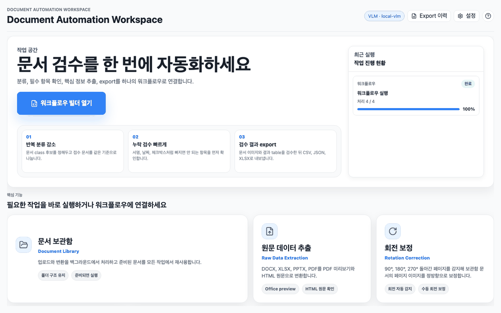
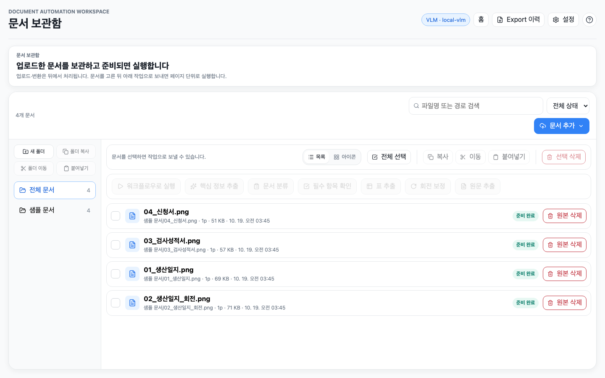
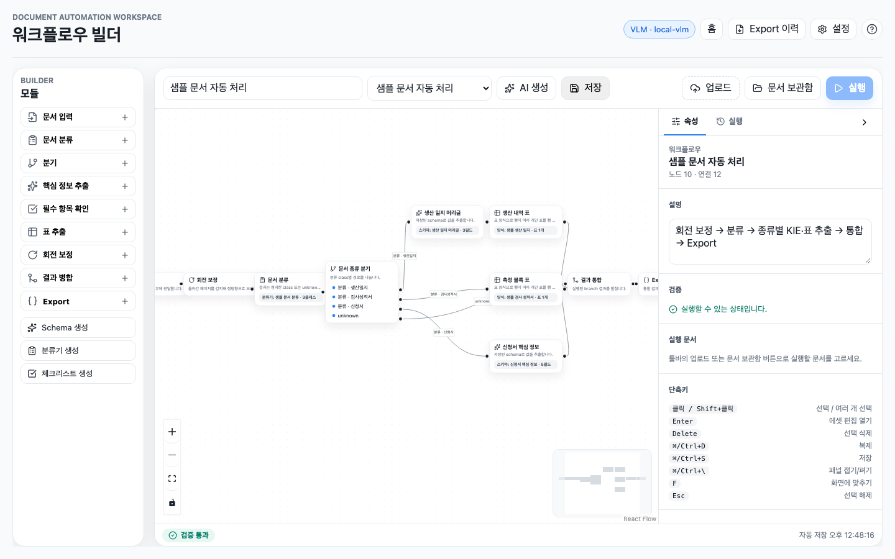
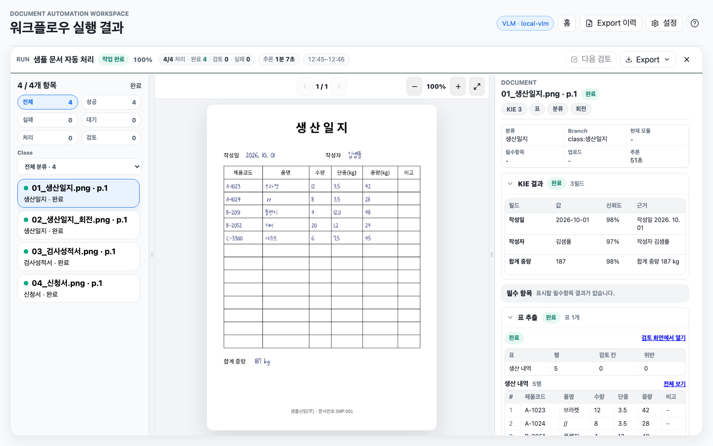
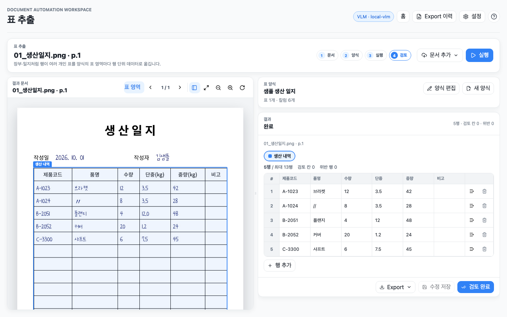
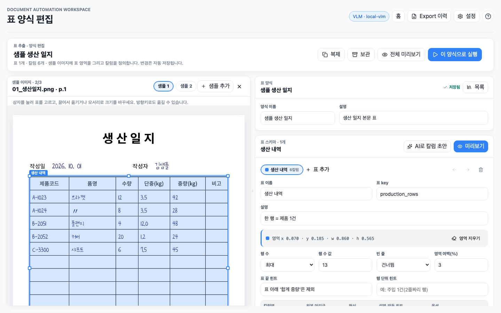

<div align="center">
  <h1>Document Automation Workspace</h1>
  <p><b>문서를 페이지 단위로 바로 세우고, 종류를 나누고, 종류별로 핵심 값과 표를 뽑아 하나의 결과로 정리하는 VLM 기반 문서 업무 자동화 앱입니다.</b></p>
  <p>
    <code>Document Library</code>
    <code>Rotation Correction</code>
    <code>Document Classifier</code>
    <code>Key Information Extractor</code>
    <code>Table Extraction</code>
    <code>Required Field Checker</code>
    <code>Raw Data Extractor</code>
    <code>Workflow Builder</code>
  </p>
</div>


> README의 화면과 시연 이미지는 모두 가상의 샘플 문서(샘플산업(주) · 홍길동 등)로 만든 것입니다.

## Demo



```bash
uv venv --python 3.11 .venv
uv pip install -e 'backend[dev]'
./scripts/run_dev.sh
```

실행 후 `http://127.0.0.1:5173/`을 엽니다. `.env.example`의 기본값은 `VLM_PROVIDER=mock`이라 외부 AI 호출 없이 화면과 워크플로우 흐름을 확인할 수 있습니다. 실제 모델을 쓰려면 `.env.example`을 `.env`로 복사하고 `VLM_PROVIDER`, `VLM_MODEL_NAME`, `VLM_API_KEY`(또는 `VLM_BASE_URL`)를 설정합니다.

## Modules

| Module | 하는 일 | 화면 |
| --- | --- | --- |
| Document Library | 파일·폴더를 보관함에 올리면 백그라운드에서 페이지 이미지로 변환하고, 모든 모듈과 워크플로우가 같은 문서를 재사용합니다. | `/documents` |
| Rotation Correction | 90°·180°·270° 돌아간 페이지를 감지해 보관함의 페이지 이미지를 정방향으로 바꿉니다. 원본 파일은 보존합니다. | `/rotation` |
| Document Classifier | 사용자가 정의한 클래스(설명·신호) 중 하나 또는 `unknown`으로 페이지를 분류합니다. | `/classifier` |
| Key Information Extractor | 스키마의 key마다 값·정규화 값·신뢰도·근거를 추출합니다. key별 영역을 지정할 수 있습니다. | `/key-info` |
| Table Extraction | 행 수가 바뀌는 장부·일지·성적서 표를 표 하나에 호출 한 번으로 읽어 행 목록으로 돌려줍니다. | `/tables` |
| Required Field Checker | 성명·날짜·서명·체크박스 같은 항목이 있는지(present/missing/uncertain/not_applicable)만 확인합니다. | `/required-check` |
| Raw Data Extractor | PDF·Office·이미지의 미리보기와 원문(HTML/PDF)을 AI 없이 만듭니다. | `/raw` |
| Workflow Builder | 위 모듈을 노드로 연결해 분기·통합·Export까지 한 번에 실행합니다. | `/workflows` |

모든 모듈은 **페이지 단위**로 동작합니다. 여러 쪽 PDF는 페이지마다 한 항목이 되고, 결과와 Export에 `page_number`가 붙습니다.

## Document Library



- 파일·폴더를 계속 추가할 수 있고, 업로드 대기열이 순서대로 처리합니다. 폴더 구조는 보관함 경로로 유지됩니다.
- 변환: PDF는 페이지 이미지로, DOCX·PPTX는 LibreOffice로 PDF 변환 후 이미지로, 이미지는 EXIF 회전을 반영한 JPEG로 만듭니다.
- 상태는 `queued` → `preprocessing` → `ready`. `ready` 문서는 바로 실행되고, 변환 중인 문서는 준비되면 자동으로 실행됩니다.
- 폴더 생성, 복사(새 저장 경로·새 document id), 이동, 선택 삭제, `Command/Ctrl+A/C/X/V`·`Delete`·`Esc` 단축키를 지원합니다.
- 문서를 지워도 과거 결과와 실행 기록은 남습니다.

## Workflow Builder



- React Flow 캔버스에서 `input` · `rotation` · `classifier` · `branch` · `kie` · `table` · `required-checker` · `merge` · `export` 노드를 연결합니다.
- `branch`는 분류 결과(`class:이름` / `unknown`)마다 경로를 나눕니다. 경로마다 다른 KIE 스키마, 표 양식, 체크리스트를 붙일 수 있습니다.
- `AI 생성`은 샘플 이미지 최대 10장을 보고 워크플로우·스키마·체크리스트 초안을 만듭니다.
- 실행은 보관함 document id를 참조하므로 같은 원본을 다시 올리지 않습니다.
- 실행 제어: 추론 일시중단 · 이어하기 · 실행 예약 · 추론 중단(문서는 보존) · 실패 항목 재시도 · 재시작.
- 실행 작업은 DB 작업 대기열에 기록되어, 서버를 재시작해도 진행 중이던 실행이 이어집니다.

### 실행 결과 검토



- 왼쪽은 페이지 목록(분류·상태), 가운데는 원본 이미지, 오른쪽은 회전 보정·분류·KIE·표 추출 결과입니다.
- 사람이 고친 값은 원본 결과와 따로 저장되고, Export에서는 수정본이 우선합니다.

## Table Extraction



KIE는 "key 하나 = 값 하나" 구조라 행 수가 바뀌는 표를 담기 어렵습니다. 표 추출은 이 표들을 **표 1개 = 모델 호출 1회**로 읽습니다.

- **양식**에 표 스키마를 여러 개 두고, 표마다 영역을 지정합니다. 영역이 없으면 페이지 전체에서 설명으로 찾습니다.
- **표 스키마**에는 이름, 설명, 영역(+여백), 표 끝 기준, 행 수(정확히/최대/모름), 빈 줄 처리, 칼럼을 둡니다.
- **칼럼**에는 이름, 원본 머리글 경로, 설명, 형식(`text` `number` `date` `time` `choice` `checkbox`), 선택지, 숫자 구분자 해석, 반복 표시(〃) 처리, 필수 여부를 둡니다.
- 모델은 칸마다 원문(`raw`)과 신뢰도만 적습니다. 숫자·날짜 변환, 〃 채우기, 판독 불가(`?`) 표시, 규칙 검사는 서버가 합니다.
- **규칙**: `row_formula`(예: `중량 = 단중 * 수량`), `unique`, `row_count`. 위반한 행은 검토 대상으로 표시됩니다.
- 검토 화면에서 원본과 결과 표를 나란히 보며 칸 수정, 행 추가·삭제를 할 수 있습니다.
- Export(XLSX)는 표 스키마마다 시트를 만들고, 검토가 필요한 칸과 검증 위반을 별도 시트로 정리합니다.



양식 편집기에서는 샘플 이미지 위에 표 영역을 그리고 칼럼을 정의합니다. `AI로 칼럼 초안`은 표 영역의 머리글을 읽어 칼럼명·머리글 경로·형식을 채웁니다. API는 [docs/table-extraction-api.md](docs/table-extraction-api.md)에 정리되어 있습니다.

## Rotation Correction

- 같은 페이지를 0°·90°·180°·270°로 돌린 후보 4장을 모델에 보여주고, 바로 선 후보를 고르게 합니다. 각도를 직접 묻는 방식보다 90°/270° 혼동이 적습니다.
- 신뢰도가 0.6 이상이면 보관함의 페이지 이미지를 바로 회전합니다. 그보다 낮으면 적용하지 않고 검토 대상으로 남깁니다.
- 회전 보정 화면에서 페이지마다 수동으로 ↺90° · ↻90° · 180° 회전할 수 있습니다.

## Input / Output

| Input | Handling |
| --- | --- |
| PDF | 페이지 이미지로 래스터화 |
| PNG/JPG/JPEG | 원본 보존, EXIF 회전 반영한 미리보기/VLM용 JPEG 생성 |
| DOCX/PPTX | LibreOffice로 PDF 변환 후 처리 |
| XLSX | 시트 HTML과 PDF 미리보기 생성 |

| Output | Format |
| --- | --- |
| Rotation | 페이지별 감지 각도, 보정 각도, 신뢰도, 적용 여부 |
| Classification | class name, confidence, reason, evidence |
| KIE | field, value, normalized value, confidence, evidence |
| Table Extraction | 표별 행 목록(칸마다 value, raw, confidence, flags), 규칙 검사 결과 |
| Required Check | 항목별 present/missing/uncertain/not_applicable |
| Workflow Export | XLSX(Export 시트 + 표별 시트 + 검토·위반 시트), CSV, JSON. 페이지별 `page_number`, 업로드/추론 소요 시간 포함 |

## Stack

| Layer | Tech |
| --- | --- |
| Frontend | Vite, React, TypeScript, React Flow, React Router, TanStack Query |
| Backend | FastAPI, SQLAlchemy, Alembic |
| Jobs | DB 기반 작업 대기열(`job_queue`), 단일 프로세스 실행 |
| Storage | 로컬 파일시스템, 선택적으로 S3 호환 저장소 |
| Document Preview | PyMuPDF, LibreOffice headless |
| VLM | OpenAI 호환(공식 API·사설 서버) / Gemini / mock |

## Local Run

Requirements: Python 3.11, Node.js 20+, LibreOffice(DOCX/PPTX/XLSX 변환).

```bash
uv venv --python 3.11 .venv
uv pip install -e 'backend[dev]'
npm ci --prefix frontend
./scripts/run_dev.sh
```

| Server | URL |
| --- | --- |
| Frontend | `http://127.0.0.1:5173` |
| Backend | `http://127.0.0.1:8000` |

`run_dev.sh`는 DB 마이그레이션(`alembic upgrade head`)을 먼저 실행합니다. 백엔드는 작업 대기열 때문에 **프로세스 하나**로 실행합니다(uvicorn `--workers` 1).

사설 OpenAI 호환 서버(vLLM 등)를 쓸 때:

```env
VLM_PROVIDER=auto
VLM_MODEL_NAME=<model-name>
VLM_BASE_URL=http://127.0.0.1:1234/v1
VLM_API_KEY=
VLM_TIMEOUT_SECONDS=300
KIE_FIELD_GROUP_SIZE=2
```

- `VLM_BASE_URL`이 있으면 엄격한 `json_schema` 대신 응답 원문에서 JSON을 파싱하고, 마크다운 펜스·앞뒤 설명·닫는 괄호 누락은 가능한 범위에서 복구합니다.
- `VLM_RESPONSE_INVALID_JSON`이 나면 모델이 JSON을 끝까지 만들지 못한 경우입니다. `KIE_FIELD_GROUP_SIZE`를 줄이거나 `max_completion_tokens`를 조정하고, 추론(thinking) 출력을 앞에 붙이는 모델인지 확인합니다.
- 화면의 설정 창에서 저장한 VLM 설정은 DB(`app_settings`)에 저장되어 `.env`보다 우선합니다. `.env`는 기본값 역할을 합니다.

## Verification

```bash
cd backend && ../.venv/bin/python -m pytest tests      # backend
npm run typecheck --prefix frontend                    # frontend types
npm run lint --prefix frontend
npm run test --prefix frontend                         # unit (vitest)
npm run build --prefix frontend
npm run e2e --prefix frontend                          # Playwright
./.venv/bin/python scripts/run_large_mock_smoke.py --count 1000
```

## Key Environment Variables

| Env | Default | Description |
| --- | --- | --- |
| `VLM_PROVIDER` | `mock` (`.env.example`) | `mock` / `openai` / `openai_compatible` / `gemini` / `auto` |
| `VLM_BASE_URL` | `""` | 사설 OpenAI 호환 서버 주소 |
| `VLM_TIMEOUT_SECONDS` | `120` | 모델 호출 1회 최대 대기 시간. 사설 서버·표 추출은 300 이상 권장 |
| `VLM_MAX_CONCURRENT_REQUESTS` | `8` | 동시에 나가는 모델 호출 수 |
| `KIE_FIELD_GROUP_SIZE` | `2` | KIE 호출 1회에 묶는 필드 수 |
| `WORKFLOW_MAX_WORKERS` | `16` | 워크플로우 페이지 처리 동시성 |
| `PREPROCESS_MAX_WORKERS` | `2` | 문서 변환 동시성 |
| `DOCUMENT_PAGE_MAX_LONG_EDGE` | `3000` | 페이지 이미지 긴 변 제한(px) |
| `DOCUMENT_PAGE_JPEG_QUALITY` | `88` | 페이지 이미지 JPEG 품질 |
| `UPLOAD_MAX_BATCH_FILES` | `10000` | 한 번에 올릴 수 있는 파일 수 |
| `UPLOAD_RETENTION_HOURS` | `0` | 문서 보존 시간(0 = 무제한) |

5,000쪽 이상 대량 처리를 자주 한다면 SQLite 대신 Postgres를 권장합니다.

## Project Documents

| Document | Purpose |
| --- | --- |
| [DEVELOPMENT_DEFINITION.md](DEVELOPMENT_DEFINITION.md) | 제품 범위, 기능 계약, 핵심 API 그룹, 검증 기준 |
| [DEVELOPMENT_PLAN.md](DEVELOPMENT_PLAN.md) | 현재 focus와 다음 작업 |
| [ERROR_NOTE.md](ERROR_NOTE.md) | 장애·오류 원인, 수정, 재발 방지 기록 |
| [docs/table-extraction-api.md](docs/table-extraction-api.md) | 표 추출 정의 모델과 API |
| [docs/project-insights.md](docs/project-insights.md) | 제품·아키텍처·VLM·워크플로우 설계 인사이트 |

## Repository

```text
backend/      FastAPI API, document processing, modules, workflow engine, job queue
frontend/     React application (features/, pages/, e2e/)
scripts/      local run and smoke scripts
docs/         public design notes and API docs
assets/       README images
```
